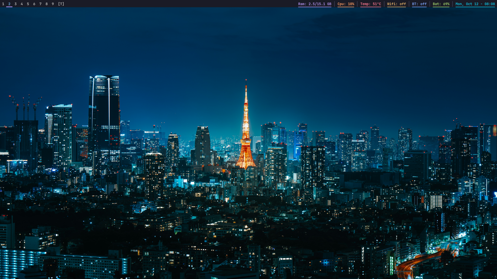
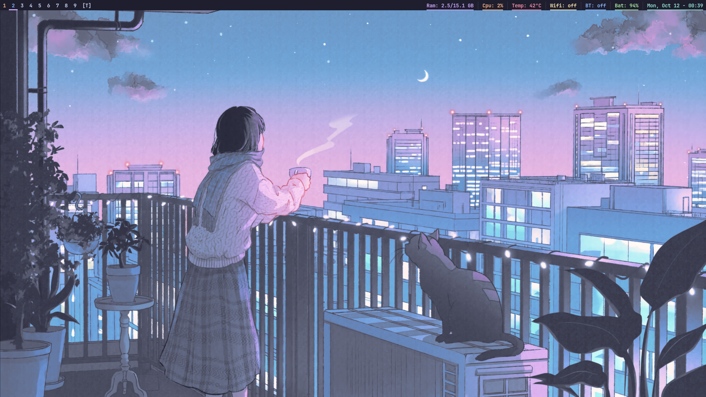

# oxi (OXWM Installer)

`oxi` (singkatan dari **OXWM Installer**) adalah script instalasi otomatis window manager **OXWM** untuk **Arch Linux, Fedora, dan Debian/Ubuntu** - cukup satu perintah, desktop siap pakai.

OXWM adalah *dynamic window manager* untuk X11 (gaya dwm, konfigurasi Lua dengan hot-reload). Sumber: https://github.com/tonybanters/oxwm - script membangunnya dari source.

## Cuplikan






## Distro yang didukung

| Distro | Package manager | Catatan |
|---|---|---|
| Arch Linux | pacman | Semua dependensi dari repo resmi |
| Debian / Ubuntu | apt | `zig` tidak ada di repo -> tarball 0.16.x otomatis (seri yang didukung oxwm); `fastfetch` di rilis lama -> `.deb` upstream |
| Fedora | dnf | Semua dependensi dari repo resmi |

## Yang dipasang script ini

- Xorg + dependensi build OXWM (`zig`, `libx11`, `libxft`, `freetype`, `fontconfig`, `libxinerama` - nama paket dipetakan otomatis per distro)
- OXWM dibangun dari source komit teruji yang di-pin (`472c7675`; `OXWM_LATEST=1` untuk HEAD), terpasang di `/usr/local/bin/oxwm` + perintah pendamping (`oxt`, `dmenu_run`/`dmenu-themed`/`dunst` bertema). Bila kelak ada biner resmi di repo distro, installer memakainya dulu (tanpa compile) dan hanya build dari source sebagai fallback
- Terminal `st` (bawaan: build 3 tema + dispatcher, ikut `oxt`) atau `alacritty`/`kitty`/`ghostty` dari repo - ketiganya ikut `oxt` via templat warna per tema
- Aplikasi pendukung: `dmenu`, `feh`, `maim`+`slop`, `xdotool`, `dunst`, `xclip`, font JetBrains Mono + Font Awesome, `btop`, `fastfetch` (Debian 13+/Ubuntu 25.04+; Debian lama ambil `.deb` upstream terpin 2.70.0 + checksum), `khal`, applet CLI (nmtui, bluetoothctl, wpctl, brightnessctl). Audio PipeWire lengkap
(pipewire + wireplumber + pipewire-pulse/pipewire-alsa agar aplikasi
PulseAudio/ALSA bersuara; socket user di-enable, grup audio ditambahkan). Font Nerd (JetBrainsMono v3.5.1 terpin + checksum) diunduh bila tak ada
- Sesi OXWM otomatis: bila display manager terdeteksi (lightdm/gdm/sddm/lxdm/slim/xdm/ly/greetd/dll) DM itu langsung dipakai + OXWM didaftarkan di `/usr/share/xsessions/oxwm.desktop`; bila tidak ada DM maka autologin getty di tty1 + `startx` otomatis. Tidak ada menu/pemasangan DM.
- Dotfiles: `~/.config/oxwm/` (config + topbar, keybind, palet + wallpaper 3 tema, dunst bertema, skrip status cpu/temp/wifi/bt) + `~/.config/khal/` + `~/.xinitrc` (config lama dibackup)
- Log instalasi: `/var/log/oxi/install.log` (fallback `./oxi.log` bila direktori itu tak bisa ditulis)

## Kebutuhan

- Salah satu: Arch Linux, Debian/Ubuntu, atau Fedora (disarankan coba di mesin virtual dulu)
- Akses `sudo` + koneksi internet
- Dijalankan sebagai user biasa via `sudo` (jangan langsung sebagai root)

## Cara penggunaan

Copy perintah di bawah ini, paste ke terminal, lalu Enter:

```bash
curl -fsSL https://raw.githubusercontent.com/itah-btw/oxi/main/oxi | sudo bash
```

Installer menampilkan TUI (ringkasan sistem, pilihan terminal, konfirmasi),
lalu memasang dengan layar progres. Untuk CI/otomasi tanpa TUI, set
`OXWM_YES=1` (pilihan bawaan: terminal `st`).

Atau cara klasik:

```bash
git clone https://github.com/itah-btw/oxi.git
cd oxi
chmod +x oxi

# 1. Instalasi penuh
sudo ./oxi

# 2. Reboot: pilih sesi OXWM di display manager (bila ada), atau
#    login konsol otomatis di tty1 -> startx jalan sendiri (bila tanpa DM)
sudo reboot
```

Installer ini **tidak memakai flag**. Di terminal, `oxi` menampilkan TUI
bergaya dankinstall: banner, ringkasan sistem, pilihan terminal dengan panah,
lalu layar progres. Tekan Enter untuk lanjut, Esc untuk kembali, Ctrl+C untuk
batal. Konfirmasi `y/N` lama tidak dipakai lagi.

Untuk otomasi/skrip dipakai environment internal (bukan flag CLI):

```bash
sudo env OXWM_YES=1 bash oxi                        # tanpa TUI, pakai bawaan
sudo env OXWM_ACTION=uninstall OXWM_YES=1 bash oxi  # hapus instalasi
sudo env OXWM_REBUILD=1 bash oxi                    # bangun ulang oxwm + st
sudo env OXWM_NO_UPDATE=1 OXWM_YES=1 bash oxi       # tanpa upgrade sistem
sudo env OXWM_LATEST=1 OXWM_YES=1 bash oxi          # oxwm dari HEAD terbaru
```

Installer memverifikasi sendiri hasilnya di akhir: biner (oxwm, st/terminal
pilihan, helper), dotfiles, tiga tema, entri sesi, autologin, font Nerd, dan
`startx`. Bila ada yang kurang, proses berhenti dengan error (bukan sukses
setengah jadi). Unduhan diperiksa checksum-nya dan gagal keras bila rusak.

OXWM dibangun dari komit teruji yang di-pin (`472c7675`, reproduksibel);
`OXWM_LATEST=1` atau `OXWM_PIN=""` untuk HEAD terbaru, `OXWM_PIN=<40-heksa>`
untuk komit lain.

Sesi otomatis tanpa menu: ada DM -> DM itu dipakai (entri `OXWM` muncul di
menu sesi; autologin buatan oxi yang lama dibersihkan agar tak berebut VT).
Tanpa DM -> login konsol otomatis di tty1, lalu `startx` jalan sendiri
memakai `~/.xinitrc`. TTY lain tetap login manual biasa. Pasang/copot DM
belakangan lalu jalankan ulang `oxi`: ia beralih sendiri antara mode DM dan
autologin.

## TUI dan pilihan terminal

Saat dijalankan di terminal, `oxi` menampilkan TUI seperti installer DMS:

1. **Ringkasan** - banner, distro/arsitektur, deteksi sesi (DM yang ada
   atau autologin), dan daftar komponen yang akan dipasang.
2. **Terminal** - `st` (bawaan: build 3 tema), `alacritty`, `kitty`,
   `ghostty` (dari repo; yang tak ada disembunyikan, mis. `ghostty`
   di Debian). Navigasi ↑/↓, Enter memilih, Esc kembali.
3. **Konfirmasi** - ringkasan akhir + peringatan; Enter mulai.
4. **Progres** - bar, tahap yang selesai/berjalan, dan output terakhir.
5. **Selesai/gagal** - langkah reboot, perintah `oxt`/`oxu`, dan log.

Tidak ada menu sesi/login manager: DM yang terdeteksi dipakai apa adanya,
tanpa DM berarti autologin tty1 + startx. Mode pipe tanpa `/dev/tty` atau
`OXWM_YES=1` melewati TUI dan memakai `st` sebagai bawaan (untuk CI/otomasi).

**Semua terminal ikut `oxt`**: ganti tema memperbarui warna terminal juga
(kitty/ghostty reload otomatis, alacritty berlaku di terminal baru). Config
baru ditemplat otomatis (`local terminal`, semua `st -e`, dan keybind
wiremix); config lama tidak diubah.

## Pembaruan (`oxu`)

`pacman -Syu` hanya meng-update paket repo - biner compile-an (oxwm, st)
tidak ikut. Untuk itu ada:

```bash
oxu            # bangun ulang hanya komponen yang outdated
oxu --check    # cek saja (tanpa root pun bisa)
```

`oxu` selalu mengunduh installer terbaru dulu (pin ikut terbaru), lalu
membandingkan dengan catatan versi di `/var/lib/oxi/`
(komit oxwm/st, versi zig/font/fastfetch). Paket repo (`dmenu`, `btop`,
`fastfetch` Debian baru, dst.) tetap urusan `pacman -Syu`/`apt upgrade`.
Bila `fastfetch` atau `zig` hilang, `oxu` memasangnya kembali (fastfetch
dari repo, zig dari tarball pin bila serinya tak cocok); `--check` butuh
jaringan untuk membandingkan dengan upstream. Mode internal
`OXWM_ACTION=uninstall` ikut membuang biner `oxu` + state ini.
Jalankan sekali `sudo ./oxi` (atau reinstall) agar perintah `oxu`
terpasang di `/usr/local/bin`.

## Shortcut dasar OXWM (config bawaan)

| Tombol | Aksi |
|---|---|
| Super + Enter | Buka terminal (bawaan `st`; ikut pilihan saat instalasi) |
| Super + D | Launcher (dmenu bertema) |
| Super + V | Riwayat clipboard (butuh `clipmenud` jalan) |
| Super + Y | Kalender (`ikhal`) |
| Super + S | Screenshot area (maim, tersimpan + clipboard) |
| Super + Q | Tutup jendela |
| Super + Shift + Q | Keluar OXWM |
| Super + Shift + R | Reload config |
| Super + J/K | Pindah fokus (tumpukan) |
| Super + H/L | Kecilkan/besarkan area master |
| Super + Shift + Space | Toggle jendela tiling ↔ apung (floating) |
| Super + 1..9 | Pindah tag |
| Super + Shift + 1..9 | Pindah jendela ke tag |

## Tema

Semua tema (`t=tokyonight`, `g=gruvbox`, `c=catppuccin`) SELALU terpasang:
st 3 varian, palet, wallpaper, dunstrc per tema. Ganti tema aktif:

```bash
oxt g   # atau oxt gruvbox
```

`oxt` menulis `~/.config/oxwm/theme`, memasang wallpaper, me-restart dunst,
lalu me-reload oxwm (reload manual dengan `Super+Shift+R` bila tak ada X).

## Troubleshooting

- **"jalankan dengan sudo"** -> pakai `sudo ./oxi`, bukan sebagai root langsung.
- **"distro tidak didukung"** -> butuh Arch Linux, Debian/Ubuntu, atau Fedora.
- **Gagal di satu paket** -> baca pesan error + log (`/var/log/oxi/install.log`), perbaiki (biasanya mirror/koneksi), jalankan ulang (script idempoten; `OXWM_REBUILD=1` bila ingin bangun ulang dari source).
- **Config lama** -> tersimpan di `~/.config-backup-TANGGAL-JAM/`, tinggal kembalikan manual.
- **Cek riwayat tahap** -> `grep '\[.*\]' /var/log/oxi/install.log`.

## Struktur repo

```
oxi/
├── oxi                              # script utama (TUI, tanpa flag CLI)
├── install.sh                       # shim kompatibilitas -> oxi (untuk URL lama)
├── bin/oxwm-theme                  # perintah ganti tema (terpasang ke /usr/local/bin)
├── bin/oxt                        # alias ke oxwm-theme
├── bin/oxu, bin/oxwm-update        # perintah pembaruan mandiri (terpasang ke /usr/local/bin)
├── bin/dmenu_run, bin/dmenu-themed # dmenu bertema (terpasang ke /usr/local/bin)
├── bin/dunst                       # dunst bertema (terpasang ke /usr/local/bin)
├── dotfiles/oxwm/config.lua         # config OXWM: topbar, keybind (baca ~/.config/oxwm/theme)
├── dotfiles/oxwm/colors/            # palet: tokyonight, gruvbox, catppuccin
├── dotfiles/oxwm/wallpapers/        # wallpaper per tema
├── dotfiles/oxwm/dunstrc-*          # config dunst per tema
├── dotfiles/oxwm/*-status.sh        # skrip blok topbar (cpu/temp/wifi/bt/vol/mic/bright)
├── dotfiles/oxwm/theme              # tema bawaan (tokyonight)
├── dotfiles/{alacritty,kitty,ghostty}/ # templat warna terminal per tema (dipakai oxt)
├── dotfiles/khal/config             # kalender lokal minimal (ikhal)
├── dotfiles/fastfetch/config.jsonc  # config fastfetch
├── dotfiles/xinitrc                 # dipakai startx
├── packages/{arch,debian,fedora}-oxwm.txt  # daftar paket
├── screenshots/                     # cuplikan layar untuk README
├── .github/workflows/ci.yml         # CI: shellcheck + install nyata (Arch/Fedora)
└── README.md
```

Opsional (ada keybind-nya di config, pasang manual bila perlu): `clipmenu`
(riwayat clipboard), `bluetui`/`wiremix` (audio), `yazi`, kalender Google via
`vdirsyncer`.

## Aplikasi opsional per distro

Keybind-nya sudah ada di config, tinggal pasang programnya:

| Aplikasi (keybind) | Arch | Debian/Ubuntu | Fedora |
|---|---|---|---|
| `yazi` (Super+E) | `pacman -S yazi` | repo pihak ketiga, atau `.deb` manual, atau `cargo install` (lihat bawah) | COPR `lihaohong/yazi`, atau Terra |
| `clipmenu` (Super+V) | `pacman -S clipmenu` | build dari source (lihat bawah) | build dari source (lihat bawah) |
| `bluetui` (Super+U) | `cargo install bluetui` | sama | sama |
| `wiremix` (Super+Shift+V) | `cargo install wiremix` | sama | sama |

Debian/Ubuntu `yazi` (tidak ada di repo resmi):

```bash
# via extrepo (Debian) atau tambah manual:
sudo apt install extrepo
sudo extrepo enable griffo  # atau griffo-free
sudo apt update && sudo apt install yazi
# alternatif: unduh .deb dari rilis upstream, lalu sudo dpkg -i yazi-*.deb
```

Fedora `yazi` (tidak ada di repo resmi, COPR ini yang didokumentasikan upstream):

```bash
sudo dnf install dnf-plugins-core
sudo dnf copr enable lihaohong/yazi
sudo dnf install yazi
```

`clipmenu` dari source (Debian/Fedora - butuh header X11 yang sudah
dipasang installer untuk build oxwm, plus `xsel`):

```bash
git clone https://github.com/cdown/clipnotify && cd clipnotify && sudo make install && cd ..
git clone https://github.com/cdown/clipmenu && cd clipmenu && sudo make install
```

`bluetui`/`wiremix` via cargo (semua distro; wiremix butuh header PipeWire
saat build: `libpipewire-0.3-dev` di Debian, `pipewire-devel` di Fedora,
`libpipewire` di Arch):

```bash
cargo install bluetui wiremix
# pastikan ~/.cargo/bin ada di PATH
```

